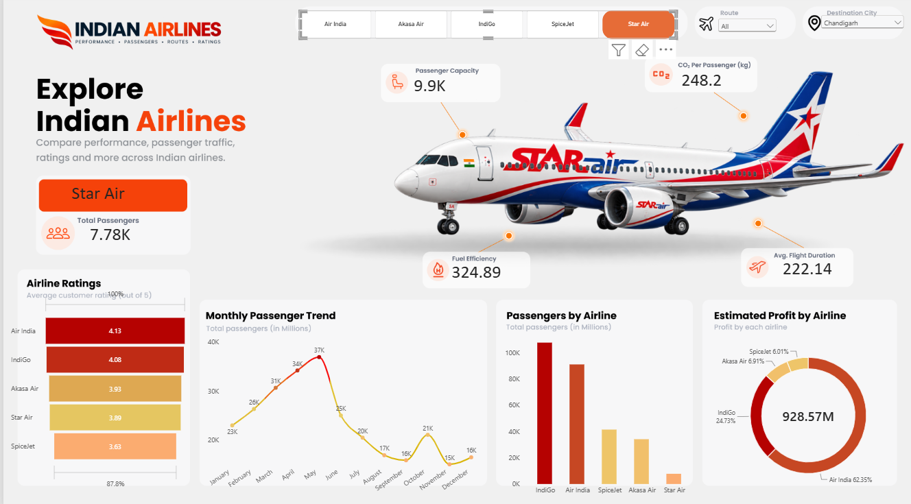

# Indian Airlines Performance Dashboard ✈️

An interactive **Microsoft Power BI** dashboard for exploring and comparing airline performance across passenger traffic, capacity, customer ratings, fuel efficiency, CO₂ emissions and estimated profitability.

The report includes airline selection and route/destination filters, KPI cards, monthly passenger trends, and airline-level comparisons.

## Dashboard Preview



[View all dashboard screenshots](https://github.com/Ritesh-fbd/Indian-Airlines-PowerBI-Dashboard/tree/main/Airline%20Analysis/image)

## Project Highlights

- **Airline comparison:** Compare Air India, IndiGo, Akasa Air, SpiceJet and Star Air.
- **Passenger analysis:** View total passengers, seat capacity and monthly passenger trends.
- **Operational indicators:** Explore fuel efficiency, average flight duration and CO₂ emissions per passenger.
- **Ratings and profitability:** Compare airline ratings and estimated profit contribution.
- **Interactive exploration:** Use airline, route and destination selectors to filter the report.
- **Aircraft visual:** Display airline/aircraft imagery as part of the report experience.

## Power BI Measures

The model includes a dedicated **Measure Table** with measures such as:

- Total Passenger
- Seat Capacity
- Avg flight duration
- CO2 per Passenger
- Fuel Efficiency
- Selected AirCraft Image

These measures support the KPI cards and report visuals. The exact DAX logic is available in the Power BI file.

## Tools & Concepts

- Microsoft Power BI Desktop
- DAX (Data Analysis Expressions)
- Power Query
- Interactive data visualization
- Multiple-table data model

## Repository Structure

```text
Indian-Airlines-PowerBI-Dashboard/
└── Airline Analysis/
    ├── airline_analysis.pbix
    ├── dataset/
    ├── image/
    └── template/
```

- **Power BI file:** [airline_analysis.pbix](https://github.com/Ritesh-fbd/Indian-Airlines-PowerBI-Dashboard/blob/main/Airline%20Analysis/airline_analysis.pbix)
- **Dataset files:** [dataset folder](https://github.com/Ritesh-fbd/Indian-Airlines-PowerBI-Dashboard/tree/main/Airline%20Analysis/dataset)
- **Images:** [image folder](https://github.com/Ritesh-fbd/Indian-Airlines-PowerBI-Dashboard/tree/main/Airline%20Analysis/image)
- **Templates/assets:** [template folder](https://github.com/Ritesh-fbd/Indian-Airlines-PowerBI-Dashboard/tree/main/Airline%20Analysis/template)

## How to Explore

1. Download `airline_analysis.pbix` from the **Airline Analysis** folder.
2. Open it in Microsoft Power BI Desktop.
3. If Power BI prompts for data-source paths, point the queries to the files in the included `dataset/` folder.
4. Use the airline, route and destination selectors to explore the report.

## Learning Outcomes

- Practised designing an interactive, multi-section Power BI report.
- Created and organised DAX measures in a dedicated Measure Table.
- Worked with multiple tables and report filters.
- Presented operational and business metrics through KPIs and visualizations.

## Notes

This is a learning and portfolio project. Metrics such as estimated profit, fuel efficiency and CO₂ per passenger are dependent on the definitions and assumptions in the underlying dataset and model; they should not be treated as verified operational figures for real-world airlines.

---

**Built by Ritesh Singh**  
[GitHub Profile](https://github.com/Ritesh-fbd)
